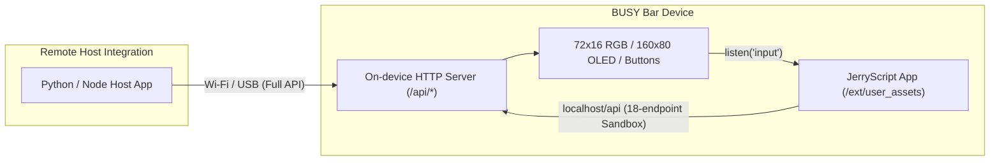

# On-device JavaScript applications

## Architecture overview

BUSY Bar supports two distinct application execution paradigms:

- **Remote host-side integrations**: Execute on an external machine or server using Python (`busybar_kit` + `busylib`) or Node.js (`@busy-app/busy-lib`). They connect over Wi-Fi or USB (`10.0.4.20`), have access to the full HTTP API and host OS capabilities, and push display frames or state updates remotely.
- **Native on-device JavaScript applications**: Installed into `/ext/user_assets/<app_id>` on the device EMMC storage and launched from the on-device APPS menu. They execute inside the firmware's embedded JerryScript runtime (ES2016+ subset), communicate with the local web server at `http://localhost/api/...`, and respond directly to physical hardware buttons and the rotary encoder[^1][^2].

## Choosing between remote host and on-device execution

| Dimension | Remote host integration (`busybar_kit`) | Native on-device app (`busy-tools`) |
|---|---|---|
| Execution environment | Host OS (Python 3.11+ or Node.js) | Embedded JerryScript VM on device |
| Memory ceiling | Host RAM | 128 KiB default heap (512 KiB maximum) |
| Hardware input | Simulated only (`POST /api/input`) | Real-time `listen("input", handler)` |
| Standalone operation | Requires host computer or server running | Runs autonomously on the BUSY Bar |
| HTTP API surface | All endpoints (`openapi.yaml`) | Restricted 18-endpoint allowlist |
| Multi-device orchestration | Supported via `config/devices.toml` | Single local device (`localhost`) |

## Toolchain and project layout

On-device applications are scaffolded, compiled, packaged, and deployed using `busy-tools` (`@busy-app/cli` and `@busy-app/create-app`), vendored as a reference submodule at `vendor/busy-tools/`[^3].

- **Node runtime requirement**: Building and packaging with `busy-cli` requires Node 24 (`>=24 <26`). Node 26 is unsupported.
- **Scaffolding command**: `npm create @busy-app/app <dir> -- --author "<Name>" --id app.<author>.<name> --name "<Title>" --description "<Desc>" --api-version 27.12.0`
- **Source structure**: `busy-cli` scans `src/` exclusively. Entry point must be `src/main.ts` or `src/main.js`. Metadata resides in `src/appmeta/manifest.json` and optional `src/appmeta/settings.json`.
- **Shared template helpers**: Scaffolded projects provide `@shared/device` (`new BusyBar({ addr: __BUSY_ADDR__ })`), `@shared/settings` (`loadValues`, `saveValues`), and `@shared/datetime`.

## Entry point and JerryScript lifecycle

- **Top-to-bottom script execution**: `src/main.ts` compiles to `scripts/main.js`. The firmware runs it once from top to bottom. It must invoke `main()` directly and must not contain any `export` statements, or `busy-cli build` fails.
- **Handle-driven process lifetime**: `main()` is not an infinite loop. After `main()` returns, the JerryScript process stays alive only while at least one handle remains active: an attached `listen("input", ...)` listener, an active `setTimeout` or `setInterval`, or an unsettled `fetch` promise.
- **Clean exit protocol**: There is no `process.exit()`. Releasing the last active timer and input listener terminates the app and returns screen control to the firmware.
- **Safe input unbinding**: Never invoke `unbind()` synchronously inside the input handler's own callback when it is the final handle, as doing so terminates the VM mid-callback. Defer unbinding via `setTimeout(unbind, 0)`.
- **Single input listener limit**: `listen("input", handler)` allows only one active handler at a time and throws a `TypeError` if called again before unbinding the previous handler.

## Resource and memory conservation

- **Heap budget**: `heap_size_kib` in `manifest.json` defaults to `128` KiB (maximum `512` KiB). Raising the heap reduces memory available to the device HTTP server and firmware subsystems.
- **Request concurrency**: Every `device.*` call executes an HTTP request against the local web server. Keep at most one `DisplayDraw` request in flight at any time; coalesce or drop intermediate frames.
- **Delta updates by element ID**: Assign stable `id` values to display elements. Send only modified elements on state changes, and remove obsolete elements explicitly with `device.DisplayClear({ application_name: APP, element_ids: [...] })`.
- **Flash wear awareness**: `localStorage.setItem` rewrites the entire application store to flash on every invocation. Keep stored values minimal and infrequent; use `src/appmeta/settings.json` and `@shared/settings` for user configuration.

## Hardware input events

Hardware controls are subscribed via `const unbind = listen("input", (event) => { ... })`:

- **Control keys (`event.key`)**: `ok` (encoder push button), `start` (large top button), `back` (back button), and `encoder` (rotary wheel).
- **Button actions (`event.action`)**: `press`, `release`, `short`, `long`, and `repeat`. Always use `short` as the default tap action; `press` fires on key-down prior to `short` on release and causes premature or duplicate triggers.
- **Reserved firmware gesture**: A `long` press on `back` is intercepted by the firmware outside the application to force-quit the running app.
- **Rotary encoder events**: Deliver `action` as `clockwise` (`delta: 1`) or `counterclockwise` (`delta: -1`).

## Sandboxed HTTP API allowlist

On-device JavaScript applications can only access the following 18 endpoints relative to `http://localhost/api/`[^1][^2]:

- **Application settings**: `apps/settings` (`GET` only, restricted to `app_id` matching the running application).
- **Display and audio**: `display/draw` (`POST`, `DELETE`), `display/brightness` (`GET`, `POST`), `audio/play` (`POST`, `DELETE`), `audio/volume` (`GET`, `POST`).
- **Busy state and identity**: `busy` (`GET`, `PUT`), `name` (`GET`), `time` (`GET`), `version` (`GET`).
- **Connectivity and status**: `wifi/status` (`GET`), `access` (`GET`), `transport` (`GET`), `status` (`GET`), `status/device` (`GET`), `status/firmware` (`GET`), `status/system` (`GET`), `status/power` (`GET`).
- **Sandboxed storage**: `storage` (`GET`, `POST`, `DELETE`, isolated strictly to the app's `/ext/data` namespace).

External HTTP(S) endpoints can also be called via `fetch` when Wi-Fi is connected. Applications must catch network errors and back off without crashing timers or input listeners.

## Manifest, settings, and asset formats

- **Manifest rules (`src/appmeta/manifest.json`)**: Requires `format_version` (`1`), `id` (reverse-domain `app.<author>.<name>`, max 32 chars, matching `^[a-zA-Z0-9_-][a-zA-Z0-9_.-]{0,31}$`), `name`, `version` (`x.y.z`), and `api_version` (`x.y.z`).
- **Settings schema (`src/appmeta/settings.json`)**: Supports `boolean`, `integer`, `string`, `enum`, `color`, `time`, `geolocation`, and nested `group` (up to 4 levels). The firmware renders the on-device settings UI automatically, though `color` and `geolocation` fields can only be edited via the Web UI or remote HTTP API.
- **Supported asset formats**: App icons in `src/appmeta/` must be `icon_front_8x8.png` (8x8 colour PNG) and `icon_back_11x11.png` (11x11 greyscale PNG). Display and audio assets must be `.png`/`.image` (`src/images/`), `.anim` (`src/animations/`), or `.snd` (`src/sounds/`). Unconverted formats (`.jpg`, `.svg`, `.mp3`, `.wav`) are placed in `resources/` and cannot be decoded by the device.

## Footnotes

[^1]: Flipper Devices Inc., "BUSY Bar JavaScript Applications Agent Guidelines (`applications_js/AGENTS.md`)", 2026, https://github.com/busy-app/busybar-firmware/blob/dev/applications_js/AGENTS.md
[^2]: Flipper Devices Inc., "JavaScript Applications (`JavaScript Applications.dox.md`)", 2026, https://github.com/busy-app/busybar-firmware/blob/dev/documentation/JavaScript%20Applications.dox.md
[^3]: Flipper Devices Inc., "BUSY Tools CLI and Scaffolding (`busy-tools`)", 2026, https://github.com/busy-app/busy-tools
